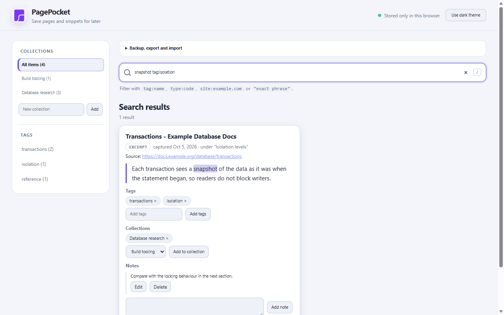
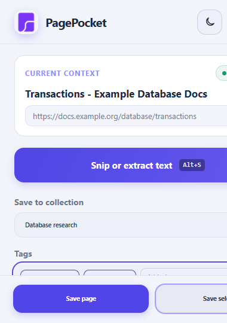
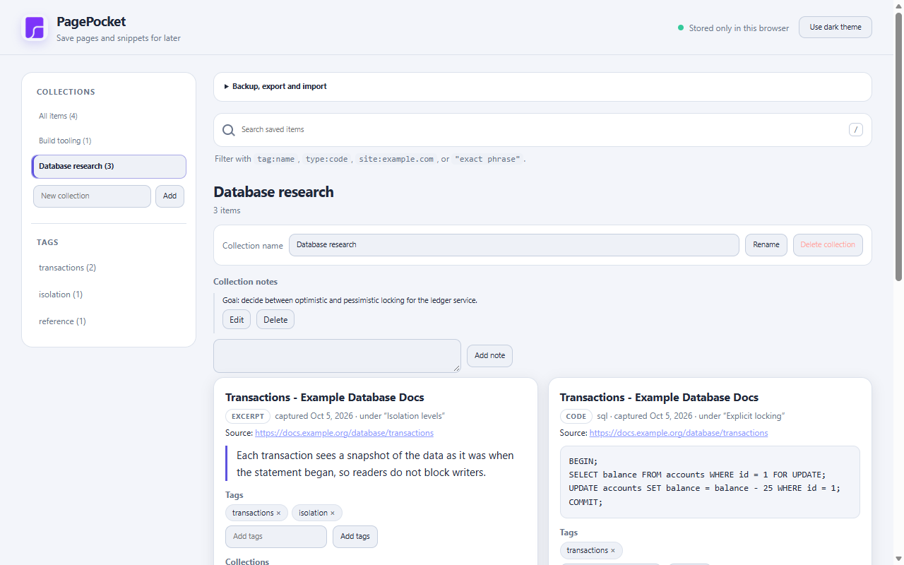

# ContextLens

Save what you read on the web with its source attached, and keep it on your own machine.

ContextLens is a browser extension for developers, researchers and students. It captures pages, selected passages, code blocks, headings and links, files each one with the page it came from, and lets you organize, search and export the result. There is no account, server or generative AI. Snip OCR uses a packaged recognition model locally; captured material stays in your browser.

> **Status: pre-release (0.1.0).** ContextLens has not been submitted to or published on the Chrome Web Store or Firefox Add-ons. Install it from source (below). It has been tested in Chromium. The Firefox build compiles but has not been loaded in Firefox yet; see [Browser support](#browser-support).


## The problem

Research on the web ends up scattered: a tab you meant to come back to, a snippet pasted into a notes file with no URL, a bookmark with no memory of why you saved it. Later you have the text but not where it came from, which section it sat under, or when you read it.

ContextLens keeps that context. Every saved item records the page URL, the canonical URL when the page declares one, the page title, the time of capture and, when it can be determined, the heading the passage sat under. Markdown exports state that the content belongs to its original authors, so a collection never reads as your own writing.

## What it does

- **Capture intentionally**: save the whole page, selected text, code, headings, links, or drag one or more rectangular snips from the visible tab. Snips are cropped before saving, so the selection overlay is never part of the image. Local English OCR can extract text from a snip; review and edit it before saving it as a source-linked excerpt.
- **Organize** with collections, manual tags, and notes on items or on a whole collection.
- **Search** your saved material locally across titles, content, tags, URLs and notes. Filters: `tag:name`, `type:code`, `site:example.com`, `"exact phrase"`. The last word also matches as a prefix.
- **Move your data**: Markdown export per collection (or everything), a complete JSON backup, and a validated import with a preview and merge or replace modes. See [the data format](docs/DATA_FORMAT.md).
- **Work offline.** Nothing depends on a network.
- **Use the keyboard.** Every control is reachable and labelled; the library has shortcuts (below).

| Search with highlighting | Popup | Dark theme |
|---|---|---|
|  |  |  |

The screenshots use invented example content on `example.org` hosts.

### What it deliberately is not

Not a chatbot, not an LLM wrapper, not a sync service and not a bookmark manager with accounts. It does not summarize, rewrite or "understand" what you save. If a deterministic browser API can do the job, that is what it uses.

## Install from source

Requires Node.js 20 or newer.

```sh
git clone <this repository>
cd contextlens
npm install
npm run build
```

**Chrome, Edge, Brave and other Chromium browsers:** open `chrome://extensions`, enable Developer mode, choose Load unpacked, and select `dist/chrome`.

**Firefox:** open `about:debugging#/runtime/this-firefox`, choose Load Temporary Add-on, and select `dist/firefox/manifest.json`. Temporary add-ons are removed when Firefox restarts. The Firefox build uses a placeholder add-on id until you set `GECKO_ID` (see [Releasing](#releasing)).

## Using it

1. On any page, click the ContextLens toolbar button (or press `Alt+Shift+L`; rebind it in your browser's extension shortcut settings).
2. Choose a collection and optionally type tags, then **Save page**, **Save selection**, **Snip & extract text**, or **Save** next to a code block, heading or link. During a snip session, drag multiple rectangles; press `Escape` when finished. The rectangles become one collage item, then an extension tab opens with locally recognized English text for review before saving it as an excerpt.
3. Select text and right-click for **Save selection to ContextLens**. The toolbar badge shows OK or !.
4. Open the library (the **Open library** button) to browse, search, tag, annotate, move items between collections and export.

| Where | Key | Action |
|---|---|---|
| Library | `/` | Focus search |
| Library | `Esc` | Clear search |
| Library | `Enter` in a tag field | Add the tags |
| Library | `Ctrl/Cmd+Enter` in a note | Save the note |
| Library | `Esc` while editing a note | Cancel |
| Popup | `Enter` in the tags field | Save the selection, or the page when nothing is selected |

## Privacy

- ContextLens makes **no network requests**. The extension source is scanned for network and code-injection APIs on every test run, and an end-to-end test records every request made by the extension and the pages it ran in. Neither found any.
- Everything you save is stored in your browser's IndexedDB. The only other thing stored is the id of the collection you used last, in the extension's local storage.
- No telemetry, no analytics, no accounts, no cloud service.
- It reads a page only when you ask: the content script is injected when you click the toolbar button or use the context menu, and nothing is stored until you press a save button. It does not collect or keep browsing history.
- Data leaves your browser only when you export a file.
- Source links open in a new tab with `noopener noreferrer`, and only `http` and `https` URLs are ever turned into links.

The full statement is in [PRIVACY.md](PRIVACY.md).

## Permissions

| Permission | Why it is needed |
|---|---|
| `activeTab` | Read the current page only after you click the toolbar button, use the keyboard shortcut or the context menu. |
| `scripting` | Inject the extraction script into that page on demand. |
| `storage` | Remember the last-used collection and light/dark theme. Saved research lives in IndexedDB, which needs no permission. |
| `contextMenus` | The "Save selection to ContextLens" entry. |

Not requested: host permissions, `tabs`, `history`, `bookmarks`, `downloads`, `cookies`, `webRequest`, or any always-on content script. A test asserts this exact set for both browsers and fails if it changes.

## Architecture

The popup, library, and background are separate contexts that share one IndexedDB database through a small `Library` service. A content script is injected on demand, reads the DOM, and returns plain data; it never touches storage. Extraction, search, and import/export are pure modules with no browser dependencies, which is why most of the suite runs without a browser.

```
src/
  background/   injection, context-menu save
  content/      on-demand content script
  extraction/   page, selection, code, link, metadata extraction (pure)
  popup/        capture UI and local snip OCR
  library/      domain rules: save, dedupe, collections, notes, tags
  search/       tokenizer, query parser, inverted index
  portability/  Markdown export, import validation, merge planner
  storage/      repository interface, IndexedDB, settings
  popup/ options/ shared/
```

Design decisions and their reasons are in [docs/ARCHITECTURE.md](docs/ARCHITECTURE.md).

## Browser support

| | Chrome / Chromium | Firefox |
|---|---|---|
| Builds | yes | yes |
| Loaded and exercised | yes | **not yet** |

Minimum versions: Chrome 114 (the build target, not a tested floor); Firefox 140 on desktop and 142 on Android, which Mozilla requires for the data-collection declaration. Details, the differences handled in code, and a manual Firefox checklist are in [docs/BROWSER_SUPPORT.md](docs/BROWSER_SUPPORT.md).

## Development

```sh
npm install
npm run dev          # rebuild dist/chrome on change
npm run check        # typecheck, tests, build both browsers
```

| Command | What it does |
|---|---|
| `npm run build` | Builds `dist/chrome` and `dist/firefox` |
| `npm run typecheck` | Type-checks sources and tests |
| `npm test` | Runs the unit and integration suite |
| `npm run e2e` | Builds, then drives the extension in Chromium |
| `npm run lint:firefox` | Runs `web-ext lint` on the Firefox build |
| `npm run screenshots` | Regenerates `docs/screenshots` |
| `npm run package` | Builds release zips (see below) |

## Testing

- `npm test` (vitest): library rules, search, import and export, validation, extraction against realistic page fixtures (GitHub, MDN, Sphinx, Docusaurus, blogs, client-rendered pages), the manifest and its permissions, a static privacy scan, and failure paths such as a full disk, a refused injection and a throwing extractor.
- `npm run e2e` (Playwright and Chromium) loads the built extension and runs three suites: `ux` (keyboard, focus, accessible names, contrast in light and dark, popup save flow), `capture` (the real injection and extraction chain on fixture pages, plus the no-network check) and `portability` (export, import, replace).
- The real `activeTab` grant and the context-menu click cannot be automated, so the `capture` suite uses a test-only build that adds host permissions. That build is never packaged.
- No screen reader testing has been done; the accessibility checks are automated.

## Releasing

```sh
npm run package:chrome                        # release/contextlens-chrome-<version>.zip
GECKO_ID=your-id@example.org npm run package:firefox
npm run package:source                        # source archive for add-on review
```

The packaging script verifies the file set, the version, the exact permission set and the description length, and **refuses to package the Firefox build while the add-on id is still a placeholder**. Zips are deterministic: the same source produces the same bytes. Drafts for store listings and a pre-submission checklist are in [docs/STORE_LISTING.md](docs/STORE_LISTING.md); nothing has been submitted.

## Contributing

Contributions are welcome. Read [CONTRIBUTING.md](CONTRIBUTING.md) first; the short version is: keep it deterministic, request no new permissions without a concrete reason, add a test, and do not add network access.

## Roadmap

Nothing below is implemented.

- Load the Firefox build in Firefox, run `web-ext lint`, and fix what turns up.
- Store submissions, after Firefox is verified.
- A keyboard command that saves the current selection without opening the popup.
- Incremental search index updates (a full rebuild per change is fine to a few thousand items).
- Search from the popup; make collection names and collection notes searchable.
- Undo for deletions; bulk tag editing; moving several items at once.
- Extraction for content inside shadow roots and same-origin iframes.
- OCR support for additional languages beyond English.

## Known limitations

- Extraction runs when you click, so content that has not rendered yet is not captured.
- Shadow DOM and iframe content is not reached.
- Highlighters that place each code line in a block-level element without newline characters collapse to one line.
- Markdown export drops hard line breaks inside a paragraph (standard Markdown joins them).
- Import is all or nothing: one invalid record rejects the whole file.
- Merge import never updates an existing record.

## License

[MIT](LICENSE)
